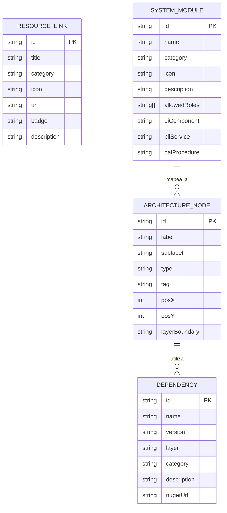
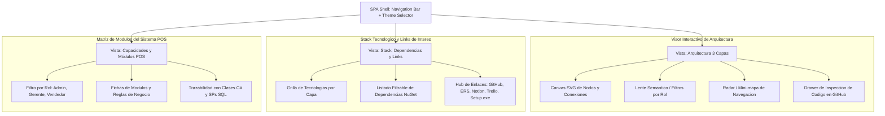

# Especificación del Sistema: Mobile Solutions - Architecture & Product Showcase SPA

## 1. Resumen Ejecutivo
- **Objetivo:** Desarrollar una Single Page Application (SPA) moderna, ligera y de alto impacto visual con **React + Vite + TypeScript**, orientada a documentar, promocionar y exponer la arquitectura de software, stack tecnológico y recursos clave del sistema original (*Mobile Solutions POS* en Windows Forms .NET).
- **Alcance (In-Scope):**
  - **[RF-01] Visor de Arquitectura en Capas:** Migración del diagrama interactivo (`mobile-solutions-architecture.html` generado por Archify) a componentes modulares React, consumiendo de forma desacoplada la especificación declarativa `candidate.json`. Incluye visualización por capas (UI, BLL, DAL, External), radar semántico (mini-mapa), selector de temas (Dark/Light) y trazador de relaciones.
  - **[RF-02] Stack del Producto, Dependencias y Links de Interés:** Módulo interactivo que expone las tecnologías y paquetes de la solución .NET (MaterialSkin.2, FontAwesome, LiveCharts, MailKit, SqlClient, SQL Server/LocalDB, Inno Setup), fichas de dependencias con versiones exactas y hub de enlaces de interés (repositorio GitHub, documentación ERS IEEE 830, tablero Trello, workspace Notion, manuales de usuario/técnico y descarga directa del instalador .exe).
  - **[RF-03] Matriz de Capacidades y Módulos del Sistema Original:** Desglose interactivo de los módulos y servicios implementados en el software de escritorio (Autenticación SHA-256 + OTP, Ventas y Carrito, Gestión de Catálogo y Stock, Clientes, Reportes Gerenciales con LiveCharts y Auditoría).
- **Fuera de Alcance (Out-of-Scope):**
  - Simulador funcional de ventas, carrito de compras y checkout en el navegador.
  - Motor de emisión o previsualización de tickets térmicos dinámicos.
  - Conexión transaccional directa a bases de datos o backend en esta fase (la SPA es 100% estática, desacoplada y orientada a presentación/showcase).
- **Asunciones:**
  - La aplicación se construirá como una SPA estática integrable en servicios de hosting modernos (Vercel, Netlify, Cloudflare Pages o GitHub Pages).
  - El archivo `candidate.json` y el `README.md` del repositorio actúan como fuentes de verdad oficiales para los componentes del diagrama y los enlaces/dependencias del ecosistema.

---

## 2. Actores y Roles de Usuario
- **Evaluador Técnico / Arquitecto de Software:** Profesional o docente que inspecciona el diseño en 3 capas, el flujo de datos entre capas, los principios arquitectónicos y las dependencias NuGet de la solución.
- **Desarrollador / Colaborador:** Programador que necesita acceder rápidamente al código fuente en GitHub, documentación técnica, manuales o especificación de requisitos ERS IEEE 830.
- **Stakeholder / Usuario Final:** Persona interesada en conocer las capacidades del producto, ver capturas/descripciones de las funciones de escritorio y descargar el instalador oficial (`MobileSolutions_Setup.exe`).

---

## 3. Requisitos Funcionales e Historias de Usuario

### [RF-01] Migración del Visualizador de Arquitectura a React + Vite
- **Historia:** Como *Evaluador Técnico*, quiero visualizar el diagrama de arquitectura en una SPA de React para explorar de manera fluida y responsiva los componentes y límites del sistema sin depender de un archivo HTML monolítico de 870 KB.
- **Criterios de Aceptación:**
  - [ ] **Escenario 1 (Renderizado de Nodos y Boundaries):** Dado que el usuario accede a la sección de Arquitectura, cuando el visor monta en pantalla, entonces se renderizan los 12 componentes agrupados en sus 4 regiones (`Presentation Layer`, `Business Logic Layer`, `Data Access Layer` y `External Infrastructure`) con sus posiciones relativas, etiquetas y tags correspondientes según `candidate.json`.
  - [ ] **Escenario 2 (Lente Semántico y Filtrado):** Dado que el usuario selecciona un rol semántico (ej. `security`, `frontend`, `backend`, `database`), cuando se aplica el filtro, entonces los componentes no coincidentes reducen su opacidad al 25% y se resaltan los nodos y conexiones coincidentes.
  - [ ] **Escenario 3 (Inspector de Componente):** Dado que el usuario hace clic en un nodo (ej. `bll_auth_sec`), cuando se abre el panel lateral de detalles, entonces se muestra la descripción, dependencias, tecnologías involucradas y el enlace directo al archivo de código en GitHub (`MobileSolutions.BusinessLayer/UserService.cs`).
  - [ ] **Escenario 4 (Mini-mapa / Radar y Paneo):** Dado un diagrama de gran extensión, cuando el usuario interactúa con el mini-mapa o arrastra el lienzo, entonces la vista debe desplazarse suavemente y reflejar el área visible actual en tiempo real.

### [RF-02] Stack del Producto, Dependencias y Links de Interés
- **Historia:** Como *Desarrollador o Evaluador*, quiero acceder a un panel unificado con el stack tecnológico, dependencias NuGet y enlaces oficiales del proyecto para consultar la documentación, tablero de trabajo y descargar el instalador del sistema.
- **Criterios de Aceptación:**
  - [ ] **Escenario 1 (Catálogo del Stack Tecnológico):** Dado el módulo de Stack, cuando el usuario ingresa, entonces se presentan agrupadas por categoría las tecnologías del sistema:
    - *Runtime & Lenguaje:* .NET 10 / .NET Framework 4.8+, C# 12/10.
    - *Capa de Presentación:* Windows Forms, MaterialSkin.2 (v2.3.1), FontAwesome.Sharp (v6.6.0), LiveCharts (v0.9.7).
    - *Capa de Lógica & Seguridad:* MailKit & MimeKit (v4.18.1), Hashing SHA-256, OTP Generator, TicketReportService.
    - *Capa de Datos & Base de Datos:* Microsoft.Data.SqlClient (v7.0.2), Microsoft SQL Server / LocalDB, Stored Procedures T-SQL, TVPs.
    - *Empaquetado & Estándares:* Inno Setup Compiler (Setup EXE), Estándar IEEE 830-1998.
  - [ ] **Escenario 2 (Filtro y Búsqueda de Dependencias):** Dado el listado de dependencias, cuando el usuario busca por nombre o filtra por capa, entonces el listado responde instantáneamente (< 50ms) mostrando versión, propósito, licencia y enlace oficial a NuGet o documentación externa.
  - [ ] **Escenario 3 (Hub de Enlaces de Interés):** Dado el panel de recursos externos, cuando el usuario visualiza los enlaces, entonces se presentan accesos directos con apertura en nueva pestaña (`target="_blank" rel="noopener noreferrer"`) a:
    - 📦 *Instalador Directo:* Descarga de `MobileSolutions_Setup.exe` (Google Drive).
    - 🐙 *Repositorio GitHub:* Código fuente oficial (`Taller-de-Programaci-n-2---2026---Grupo-97`).
    - 📋 *Documentación ERS:* PDF de Especificación de Requisitos bajo estándar IEEE 830-1998.
    - 📑 *Workspace Notion:* Documentación funcional y actas de desarrollo.
    - 📌 *Tablero Trello:* Tablero SCRUM de historias de usuario y sprint backlog.
    - 📖 *Manuales Oficiales:* Manual de Usuario, Documentación Técnica de Devs y Guía de Instalación (Google Docs).

### [RF-03] Matriz de Capacidades y Módulos del Sistema Original
- **Historia:** Como *Stakeholder Comercial*, quiero explorar una matriz interactiva con las funcionalidades del sistema de escritorio original para conocer en detalle qué tareas resuelve la aplicación en cada área del negocio.
- **Criterios de Aceptación:**
  - [ ] **Escenario 1 (Exploración por Módulo de Negocio):** Dado el visor de módulos, cuando el usuario navega entre las pestañas (Ventas, Catálogo, Clientes, Reportes, Seguridad, Backups), entonces se muestran las tarjetas de características con descripción de la regla de negocio, controles de interfaz involucrados (ej. `SaleView.cs`, `ManagerReportControl.cs`) y roles de acceso permitidos (Admin, Gerente, Vendedor).
  - [ ] **Escenario 2 (Trazabilidad con Requisitos):** Dado el detalle de una funcionalidad (ej. "Control de Stock en Tiempo Real"), cuando el usuario lo expande, entonces se muestra la trazabilidad con el requisito de software formal (ID en ERS) y el procedimiento almacenado SQL asociado (ej. `SaleSP.sql`).

---

## 4. Arquitectura y Modelo de Datos (Alto Nivel)

### 4.1 Modelo de Entidades de la SPA (Datos Declarativos)



### 4.2 Flujo de Navegación de la SPA



### 4.3 Estructura de Directorios del Proyecto Vite + React

```text
mobile-solutions-spa/
├── public/
│   ├── favicon.ico
│   └── data/
│       ├── architecture.json      # Declaracion de componentes y conexiones (candidate.json)
│       ├── dependencies.json      # Stack .NET, versiones NuGet y clasificacion
│       ├── links.json             # Enlaces oficiales (GitHub, Notion, Trello, Docs, Setup.exe)
│       └── modules.json           # Matriz de funcionalidades del sistema POS
├── src/
│   ├── assets/                    # Iconos vectoriales y logos
│   ├── components/
│   │   ├── common/                # Navbar, Footer, ThemeToggle, Card, Badge, Modal
│   │   ├── architecture/          # ArchitectureCanvas, NodeItem, EdgeConnection, SemanticLens, Radar
│   │   ├── stack/                 # TechBadgeGrid, DependencyTable, DependencyFilter
│   │   ├── links/                 # ResourceLinkCard, DownloadSection, ExternalLinkButton
│   │   └── modules/               # ModuleGrid, RoleBadge, FeatureDetailModal
│   ├── types/
│   │   ├── architecture.types.ts
│   │   ├── stack.types.ts
│   │   └── modules.types.ts
│   ├── hooks/                     # useTheme, useArchitectureFilter
│   ├── App.tsx                    # Shell principal con navegacion por tabs
│   ├── main.tsx                   # Punto de entrada Vite
│   └── index.css                  # Estilos Tailwind y tokens de color
├── package.json
├── tailwind.config.js
├── tsconfig.json
└── vite.config.ts
```

---

## 5. Requisitos No Funcionales (NFRs)
- **Rendimiento de Carga:**
  - First Contentful Paint (FCP) < 0.6 segundos en conexiones estándar.
  - Tamaño de bundle JS comprimido (Gzip/Brotli) < 120 KB (eliminando dependencias de formularios o validaciones pesadas).
  - Cero dependencias de backend en runtime; toda la información se carga como recursos JSON estáticos precacheados.
- **Diseño & Experiencia de Usuario (UI/UX):**
  - Paleta de color coherente con la identidad original: Azul oscuro principal `#0B132B`, Cian de realce `#00B4D8`, Azul secundario `#2A69AC` y Gris neutro `#64748B`.
  - Modo Oscuro por defecto con soporte para cambio instantáneo a Modo Claro respetando preferencias del sistema (`prefers-color-scheme`).
  - Totalmente responsivo en resoluciones desktop, tablet y móviles (diagrama adaptable con zoom táctil y paneo).
- **Mantenibilidad & Simplicidad:**
  - Código TypeScript estricto (`strict: true`).
  - Separación total entre la capa de presentación React y los datos estructurados en archivos JSON (`public/data/`), facilitando actualizaciones futuras de dependencias o enlaces sin tocar componentes visuales.

---

## 6. Plan de Implementación Sugerido (Fases)

### Fase 1: Scaffold del Proyecto y Base de Diseño (Core)
1. Inicialización de la aplicación con `vite` (`template: react-ts`), configuración de `tailwindcss` y `lucide-react`.
2. Definición del sistema de tokens de color corporativo (`#0B132B`, `#00B4D8`, etc.) y hook de tema claro/oscuro.
3. Creación del Layout principal con Navbar fija, selector de tema y navegación entre las tres vistas principales:
   - *Arquitectura 3 Capas*
   - *Stack & Dependencias*
   - *Módulos & Capacidades POS*

### Fase 2: Implementación de la Vista de Stack, Dependencias y Links de Interés (RF-02)
1. Estructuración de los archivos JSON de datos (`dependencies.json` y `links.json`) con las versiones y links reales del proyecto.
2. Construcción de las tarjetas de enlaces destacados (Descarga de `MobileSolutions_Setup.exe`, GitHub, Notion, Trello, ERS IEEE 830).
3. Construcción de la tabla/grilla de dependencias y tecnologías con buscador y filtros por capa (.NET, UI, BLL, DAL, Tooling).

### Fase 3: Migración e Integración del Visor de Arquitectura (RF-01)
1. Integración de `candidate.json` en `architecture.json`.
2. Desarrollo del lienzo vectorial SVG/React responsivo que dibuje las 4 capas, nodos y conexiones con colores de estado.
3. Implementación del Lente Semántico para destacar roles de componentes y del drawer lateral de detalles.

### Fase 4: Matriz de Módulos del Sistema POS y Ajustes Finales (RF-03)
1. Creación de la grilla de módulos del sistema Windows Forms original con filtros por rol (Admin, Gerente, Vendedor).
2. Trazabilidad con archivos de código C# en GitHub y procedimientos almacenados.
3. Auditoría de rendimiento con Lighthouse, validación de enlaces externos y preparación para despliegue en plataforma estática.

---

## 7. Preguntas Abiertas / Decisiones Pendientes
- **Ubicación en el Workspace:** ¿El proyecto de la SPA se creará en un subdirectorio dedicado (por ejemplo, `mobile-solutions-web/` o `web/`) dentro de la raíz para convivir limpiamente con el directorio `repo/` existente?
- **Despliegue inicial:** ¿Se prevé una configuración para despliegue automático mediante GitHub Actions hacia GitHub Pages o Vercel?
